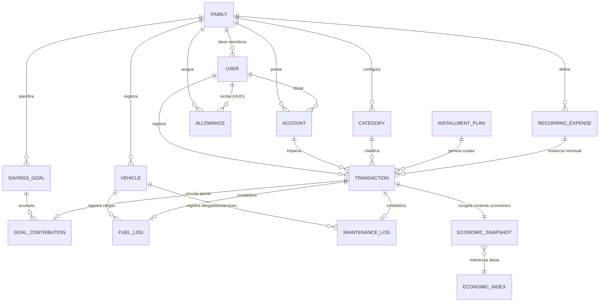

# 03 — Modelo de Dominio

## 1. Diagrama Entidad-Relación (Conceptual)

---

## 2. Entidades Principales

### Núcleo Familiar y Seguridad
- **`Family`**: Identificador del hogar, nombre, moneda base elegida (`base_currency`, ej. `ARS`), moneda/índice de referencia estable (`reference_currency`, ej. `USD_MEP`, `USD_BLUE`, `EUR`, `UVA`) y zona horaria.
- **`FamilyCurrency`**: Divisas habilitadas por la familia (`ARS`, `USD`, `EUR`, `USDT`, etc.) y preferencia de fuente de cotización para cada una.
- **`User`**: Email, password hash, nombre, `family_id`, `role` (`ADULTO` | `HIJO`), `family_visibility` (`OWN_ONLY` | `FAMILY_SUMMARY` | `FAMILY_FULL` — configurable por los adultos para cada hijo; siempre `FAMILY_FULL` para adultos), `theme_preference` (`LIGHT` | `DARK` | `SYSTEM`), `accent_color`, estado activo.
- **`RefreshToken`**: Token rotatorio asociado a `User` con expiración y revocación para sesiones JWT seguras.
- **`Allowance` (Mensualidad)**: Vincula un adulto asignador, un usuario `HIJO`, monto, moneda, regla de actualización (fija o IPC), frecuencia (mensual/semanal) y cuenta destino del hijo.

### Contabilidad, Multimoneda y Motor Anti-Inflación
- **`Account` (Cuenta / Medio de Pago)**: Nombre, tipo (`CASH`, `BANK`, `WALLET`, `CREDIT_CARD`, `SAVINGS`), moneda (`currency_code`), saldo inicial, `owner_user_id` (opcional si es compartida), `closing_day` y `due_day` (solo tarjetas de crédito).
- **`Category`**: Nombre, tipo (`EXPENSE` | `INCOME`), ícono/color, `parent_category_id` (para subcategorías), `is_system` (categorías base vs. personalizadas).
- **`CurrencyExchange` (Compra/Venta de Divisas)**: Registra operaciones entre cuentas de distinta moneda guardando `source_account_id`, `target_account_id`, `source_amount`, `source_currency`, `target_amount`, `target_currency`, **`applied_exchange_rate`** (tipo de cambio real al que se compró/vendió), `fee_amount` y `exchange_date`. Vincula las dos `Transaction` espejo (`EXCHANGE_OUT` y `EXCHANGE_IN`).
- **`Transaction` (Movimiento)**:
  - `type`: `EXPENSE`, `INCOME`, `TRANSFER_OUT`, `TRANSFER_IN`, `EXCHANGE_OUT`, `EXCHANGE_IN`, `ALLOWANCE_OUT`, `ALLOWANCE_IN`.
  - `scope`: `PERSONAL` (visible por defecto al usuario y consolidado con detalle para los adultos en la vista familiar) | `FAMILY` (gasto común del hogar).
  - `amount`, `currency_code`, `transaction_date`, `account_id`, `category_id`, `user_id` (quien registra/paga), `attributed_to_user_id` (a qué integrante de la familia se imputa el gasto; por defecto igual a `user_id`, editable por `ADULTO`), `description`, `receipt_attachment_id`.
- **`EconomicIndex` (Índices Económicos)**: Tabla maestra diaria/mensual con cotizaciones históricas (`USD_OFICIAL`, `USD_MEP`, `USD_BLUE`, `EUR_OFICIAL`, `EUR_BLUE`, `UVA`, `IPC_MENSUAL`).
- **`EconomicSnapshot` (Foto Económica por Transacción)**: Congela al momento de la transacción la cotización de referencia de la familia, el valor UVA/IPC del período y el `amount_in_reference_currency`, garantizando reportes rápidos e inmutables.

### Cuotas, Gastos Fijos y Metas
- **`InstallmentPlan` (Plan de Cuotas)**:
  - `total_installments`, `has_interest`, `cash_price` (precio contado opcional), `financed_total`, `installment_amount`, `currency`, `start_billing_month`, `credit_card_account_id`.
  - Genera `N` transacciones (o cuotas vinculadas con estado `PROJECTED`, `BILLED`, `PAID`).
- **`RecurringExpense` (Gasto Fijo Mensual)**:
  - Nombre, categoría, cuenta sugerida, monto base, moneda, día de vencimiento, `adjustment_rule` (`MANUAL`, `IPC`, `USD`, `LAST_PAID`), estado activo.
- **`SavingsGoal` (Meta de Ahorro)** y **`GoalContribution`**:
  - Nombre, alcance (`PERSONAL` | `FAMILY`), monto objetivo, moneda/unidad (`ARS`, `USD`, `UVA`, `ARS_IPC`), fecha objetivo y registro de aportes.

### Módulo de Vehículos
- **`Vehicle`**: Marca, modelo, año, patente, tipo de combustible, kilometraje actual (`current_odometer_km`), fecha vencimiento VTV, fecha vencimiento seguro, notas.
- **`FuelLog` (Carga de Combustible)**: `vehicle_id`, `transaction_id`, fecha, `odometer_km`, `fuel_type`, `liters`, `price_per_liter`, `total_amount`, `full_tank` (booleano clave para cálculo exacto de consumo), estación.
- **`MaintenanceLog` (Desgaste / Service)**: `vehicle_id`, `transaction_id`, tipo (`SERVICE`, `OIL_CHANGE`, `TIRES`, `BRAKES`, `BATTERY`, `REPAIR`, `VTV`, `OTHER`), fecha, `odometer_km`, descripción, taller, `next_due_km`, `next_due_date`.

---

## 3. Reglas Críticas de Negocio

### Regla 1: Cero Doble Conteo en Mensualidades de Hijos
Cuando un adulto entrega $50.000 de mensualidad a un hijo, y el hijo gasta $30.000 en salidas/juegos:
- La entrega de la mensualidad se registra como `ALLOWANCE_TRANSFER` (transferencia interna entre cuenta del adulto y cuenta del hijo). **No cuenta como gasto del hogar consolidado** para no duplicar.
- Los $30.000 que gasta el hijo sí se registran como `EXPENSE` en su cuenta.
- Resultado:
  - En la **vista personal del hijo**, ve su mensualidad disponible ($50.000), sus gastos ($30.000) y su saldo ($20.000).
  - En la **vista familiar consolidada**, el gasto real consumido por la familia refleja los $30.000 efectivamente gastados (no $80.000).

### Regla 2: Impacto Temporal de Cuotas
- Una compra en 6 cuotas realizada en marzo se muestra en el flujo mensual de **marzo a agosto** (o abril a septiembre según fecha de cierre de la tarjeta), no como un único gasto de golpe en marzo.
- Sin embargo, el usuario puede consultar tanto el **flujo de caja mensual** (cuotas que vencen ese mes) como el **compromiso total de deuda pendiente**.

### Regla 3: Integridad Contable de Vehículos
- Si el usuario carga una carga de combustible o un service desde el módulo de Vehículos, el backend crea en una misma transacción ACID la `Transaction` (categoría Vehículos -> Combustible o Mantenimiento) y el `FuelLog`/`MaintenanceLog`.
- Si se edita el monto o se elimina el registro desde cualquiera de los dos lados, ambos se mantienen sincronizados.
- El `current_odometer_km` del vehículo se actualiza automáticamente si la carga o service ingresa un kilometraje mayor al actual (validando que no sea inconsistente con fechas anteriores).

### Regla 4: Precisión Monetaria y Fechas
- Todas las cantidades monetarias usan `NUMERIC(19, 4)` (4 decimales internos para evitar errores de redondeo en litros, cotizaciones y prorrateo de cuotas).
- Las fechas contables se manejan como `LocalDate` (`DATE` en PostgreSQL) en zona horaria de la familia (`America/Argentina/Buenos_Aires` por defecto) para evitar corrimientos de día por UTC al agrupar por día/semana/mes.

### Regla 5: Atribución de Gastos a Otro Miembro de la Familia
Cuando un `ADULTO` paga un gasto destinado a otro miembro (ej. un padre/madre le entrega $20.000 a su hijo para salir de fiesta):
- `user_id` guarda al adulto que registró/pagó el movimiento y `account_id` descuenta el dinero de la cuenta real de origen (ej. efectivo o Mercado Pago del adulto).
- `attributed_to_user_id` guarda al miembro beneficiario (el hijo).
- **Impacto en vistas y gráficos:**
  - El **saldo de cuenta** del adulto refleja correctamente la salida de $20.000.
  - En la **vista de gastos personales del adulto**, esos $20.000 **no suman** como gasto propio.
  - En la **vista personal del hijo** y en el **gráfico de torta Por Personas**, esos $20.000 se contabilizan bajo el hijo (con indicación discreta *"Pagado por [Adulto]"*).
  - En la **vista familiar consolidada**, el gasto cuenta una sola vez ($20.000).
- Solo los usuarios con rol `ADULTO` pueden asignar un `attributed_to_user_id` distinto a sí mismos (siempre dentro de su misma `family_id`).
