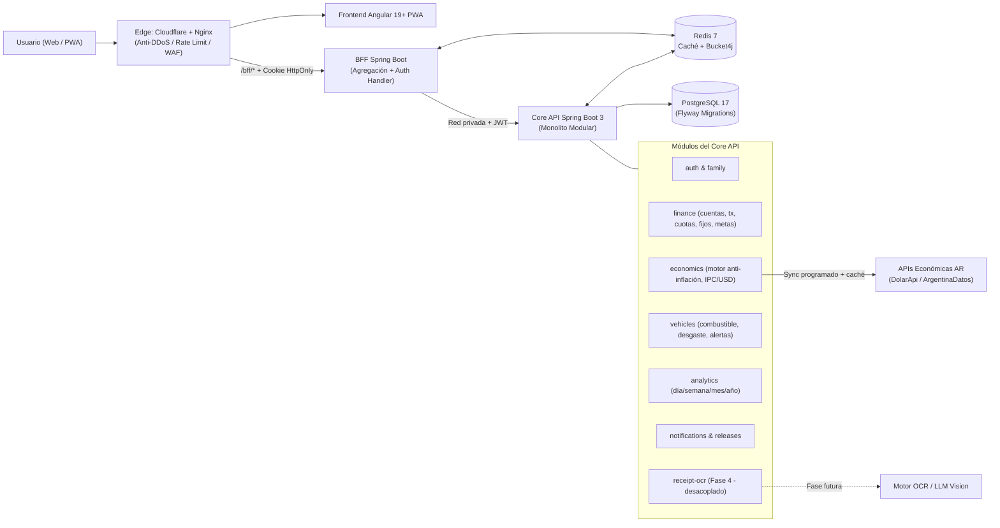

# 04 — Arquitectura y Stack Tecnológico

## 1. Stack Tecnológico Moderno

| Capa | Tecnología | Justificación |
|---|---|---|
| **Edge / Seguridad** | **Cloudflare + Nginx (Docker)** | Anti-DDoS L3/L4/L7, WAF, rate limiting por IP, anti-scrapeo, anti-Slowloris y Security Headers. |
| **BFF** | **Java 21 LTS + Spring Boot 3.4+ (Maven)** | Único punto de entrada de la PWA: maneja JWT en cookies `HttpOnly`, agrega payloads mobile (`/bff/home`) y aplica rate limit por usuario. |
| **Core Backend** | **Java 21 LTS + Spring Boot 3.4+ (Maven)** | Monolito modular en red interna privada: finanzas, motor anti-inflación, cuotas, vehículos y notificaciones. |
| **Caché y Rate Limit** | **Redis 7** | Caché de cotizaciones/IPC y dashboards con invalidación `AFTER_COMMIT`, contadores Bucket4j y revocación inmediata de sesiones. |
| **Seguridad** | **Spring Security 6 + JWT (vía BFF Cookies `HttpOnly`)** | Access Token corto (15 min) + Refresh Token rotatorio en DB, protección CSRF, RBAC (`ADULTO` / `HIJO`) y aislamiento por `family_id`. |
| **Persistencia** | **PostgreSQL 17 + Spring Data JPA + Flyway** | Integridad ACID, tipos `NUMERIC` precisos, consultas analíticas por ventana temporal (día/semana/mes/año) y migraciones versionadas. |
| **Documentación API** | **SpringDoc OpenAPI 3 (Swagger UI)** | Contrato API autogenerado y sincronizado con el BFF y frontend. |
| **Frontend (PWA)** | **Angular 19+ (Standalone + Signals + `@angular/pwa`)** | Web 100% instalable como atajo en inicio de celular, reactividad fina con Signals y TypeScript estricto. |
| **UI & Gráficos** | **Tailwind CSS + Gráficos SVG / ECharts** | Diseño mobile-first minimalista (monocromático + color de perfil) y gráficos de torta interactivos. |
| **Emails (2FA / Reset)** | **Spring Mail + Thymeleaf / Mailpit (local)** | Códigos 2FA por email, recuperación de contraseña e invitaciones. Mailpit en Docker local para pruebas y SMTP transaccional (Resend/Brevo/SES) en prod. |
| **Contenedores** | **Docker + Docker Compose** | Levantar Edge + Frontend + BFF + Core API + Redis + PostgreSQL + Mailpit en un comando, garantizando entornos idénticos. |
| **Testing** | **JUnit 5 + Testcontainers (PostgreSQL) + Vitest/Playwright** | Pruebas reales contra PostgreSQL (crítico para cálculos financieros, cuotas y agregaciones temporales). |

---

## 2. Arquitectura General

Se propone un **Monolito Modular** en el backend (con fronteras claras por dominio) en lugar de microservicios prematuros. Esto da velocidad de desarrollo para un equipo chico o individual, mantiene transacciones ACID simples (ej. `Vehicle` + `Transaction`), y permite extraer servicios pesados a futuro (como el procesador OCR de tickets) si hiciera falta.



---

## 3. Estructura Propuesta del Repositorio (Monorepo)

```text
FamiliON/
├── .github/workflows/          # CI/CD (ci.yml, cd-staging.yml, cd-release.yml)
├── docs/                       # Documentación funcional, técnica, DB y brand SVG
├── edge/                       # Nginx reverse proxy (rate limit, anti-scrapeo, headers)
├── bff/                        # BFF Java 21 + Spring Boot 3 (Maven) — Cookies HttpOnly + Agregación
├── backend/                    # Core API Java 21 + Spring Boot 3 (Maven)
│   ├── src/main/java/com/familion/
│   │   ├── auth/               # Login, registro, JWT, refresh tokens
│   │   ├── family/             # Familias, miembros, roles, mensualidades
│   │   ├── economics/          # Cotizaciones USD, IPC, UVA, motor de conversión
│   │   ├── finance/            # Cuentas, ingresos, gastos, cuotas, fijos, metas
│   │   ├── vehicles/           # Vehículos, combustible, desgaste/services
│   │   ├── analytics/          # Agregaciones por día/semana/mes/año
│   │   ├── notifications/      # Notificaciones in-app, Web Push y changelog
│   │   ├── receipts/           # Módulo futuro de adjuntos y escaneo OCR
│   │   └── common/             # Excepciones, auditoría, seguridad, caché Redis
│   └── src/main/resources/
│       └── db/migration/       # Scripts SQL Flyway (V1__, V2__, ...)
├── frontend/                   # Proyecto Angular 19+ PWA + Tailwind CSS
│   └── src/app/
│       ├── core/               # Auth (cookies BFF), interceptores CSRF, SwUpdate, tema/color
│       ├── shared/             # Logo SVG, pipes de divisa/IPC, gráfico Donut, carga rápida
│       └── features/           # home, plan, vehicles, profile, auth
└── docker-compose.yml          # Orquestación local (edge, frontend, bff, backend, redis, postgres)
```

---

## 4. Decisiones de Arquitectura Clave

### 4.1 Autenticación y Autorización con JWT
- **Claims del Access Token:** `sub` (userId), `familyId`, `role` (`ADULTO` | `HIJO`), `exp` (15 minutos).
- **Refresh Token:** Almacenado hasheado en PostgreSQL con rotación en cada uso y revocación en logout.
- **Aislamiento Multi-Familia:** Todo servicio filtra obligatoriamente por el `familyId` extraído del token verificado (nunca confiado desde el body del cliente).
- **Control de Roles:** Anotaciones `@PreAuthorize` en endpoints sensibles (ej. solo `ADULTO` puede crear vehículos, configurar mensualidades o editar gastos fijos familiares).

### 4.2 Integración con Índices Económicos de Argentina
- Un `@Scheduled` diario consulta fuentes públicas (como `DolarApi` y `ArgentinaDatos` para dólar oficial/MEP/blue, UVA e IPC mensual) y persiste los valores en `economic_index`.
- Todas las consultas de usuario leen **exclusivamente desde PostgreSQL** (nunca bloquean esperando una API externa).
- Incluye endpoint administrativo/familiar para carga o ajuste manual en caso de caída de proveedores externos.

### 4.3 Estrategia para Escaneo de Tickets (Preparado desde el Día 1)
Para no complicar el MVP pero dejar el camino listo:
1. Las transacciones ya contemplan un campo opcional `receipt_attachment_id`.
2. El módulo `receipts` expondrá una interfaz `ReceiptParserPort` que recibe una imagen y devuelve un DTO sugerido (`merchant`, `date`, `totalAmount`, `currency`, `suggestedCategory`, `confidence`).
3. En el futuro se podrá conectar tanto una opción **100% local/gratuita** (ej. contenedor con Tesseract/PaddleOCR + reglas de parsing) como una opción **de mayor precisión** (modelo Vision / LLM API) sin cambiar el resto del backend ni del frontend.

### 4.4 Entorno con Docker Compose
El `docker-compose.yml` definirá inicialmente:
- `postgres`: PostgreSQL 17 con volumen persistente y healthcheck.
- `backend`: Spring Boot con perfil `dev` (variables de entorno para DB, secreto JWT y URLs de APIs económicas).
- `frontend`: Angular servido en modo desarrollo o build Nginx con proxy reverso hacia `/api`.
