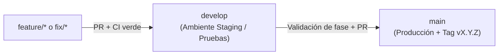

# 08 — PWA (Atajo en Inicio), CI/CD, Versionado y Notificaciones

Este documento define cómo **FamiliON** se entrega como aplicación **100% web instalable (PWA)**, cómo se gestionan versiones y pruebas por fases sin romper nada (**CI/CD**), y cómo se notifican los cambios tanto al equipo técnico como a la familia.

---

## 1. Web Instalable como App (PWA — sin App Nativa)

FamiliON será **exclusivamente una aplicación web** (Angular 19+ responsive mobile-first), configurada como **Progressive Web App (`@angular/pwa`)** para que cualquier integrante pueda agregarla como **atajo rápido en la pantalla de inicio** de Android o iOS y usarla como una app más.

### Requisitos PWA en el Frontend
- **`manifest.webmanifest`:**
  - `name`: `"FamiliON"` / `short_name`: `"FamiliON"`
  - `display`: `"standalone"` (se abre a pantalla completa sin la barra de direcciones del navegador).
  - `start_url`: `"/"`
  - `icons`: set completo (`72`, `96`, `128`, `144`, `192`, `384`, `512` px + versión `maskable`) generados desde [familion-icon.svg](./brand/familion-icon.svg).
  - `theme_color` y `background_color` sincronizados con el tema claro/oscuro.
- **Meta tags para iOS (Safari):** `apple-mobile-web-app-capable`, `apple-mobile-web-app-status-bar-style` y `apple-touch-icon` para que en iPhone también quede instalada limpia.
- **Service Worker (`ngsw-config.json`):**
  - Caché del shell de la aplicación para apertura instantánea.
  - Estrategia *freshness* para llamadas `/api/v1/*` (nunca mostrar saldos financieros obsoletos).
  - Detección automática de nuevas versiones mediante `SwUpdate` de Angular.
- **Prompt discreto de instalación:** banner mínimo la primera vez que se abre desde el navegador móvil explicando cómo agregarla al inicio (botón directo en Android/Chrome o mini-guía de 2 pasos en Safari iOS).

---

## 2. Estrategia de Ramas, Fases y Versionado Semántico

Para probar por fases y lanzar parches chicos sin romper lo que ya usa la familia:

### Versionado Semántico (`SemVer`)
- `v0.1.0`, `v0.2.0`, `v0.3.0`… → **Fases del Roadmap** (nuevas funcionalidades probadas).
- `v0.2.1`, `v0.2.2`… → **Parches chicos / correcciones** (`fix:`) que no rompen compatibilidad.
- `v1.0.0` → Primera versión estable completa para uso diario.

### Flujo de Ramas (GitFlow simplificado)

- **`feature/<nombre>` / `fix/<nombre>`:** ramas cortas para cada cambio.
- **`develop` (Staging):** se despliega automáticamente para probar cada fase antes de pasarla a la familia.
- **`main` (Producción):** protegida (no permite push directo). Solo recibe merges desde `develop` (o `hotfix/*`) con **CI 100% en verde** y genera un tag `vX.Y.Z` + Release.

### Conventional Commits
Todos los commits siguen formato estándar para generar changelogs automáticos:
- `feat(vehicles): agregar registro de carga de combustible`
- `fix(installments): corregir redondeo en última cuota`
- `docs(db): actualizar esquema de notificaciones`
- `chore(ci): ajustar caché de Maven`

---

## 3. Pipeline de CI/CD (GitHub Actions)

Se configurarán workflows en `.github/workflows/`:

### 3.1 `ci.yml` — Integración Continua (en cada PR y push a `develop` / `main`)
1. **Backend (`backend/`):**
   - `mvn -B verify` con Java 21.
   - Tests unitarios (JUnit 5 + Mockito).
   - Tests de integración con **Testcontainers (PostgreSQL 17)** validando que **todas las migraciones Flyway** aplican limpiamente desde cero y que los cálculos críticos (cuotas, snapshots, atribución de gastos) no tienen regresiones.
2. **Frontend (`frontend/`):**
   - `npm ci`
   - Lint + TypeScript strict check.
   - Tests unitarios.
   - `npm run build -- --configuration production` (verifica que el bundle PWA compila sin errores).
3. **Docker:**
   - Verificación de `docker compose config` y build de imágenes `backend` y `frontend`.

### 3.2 `cd-staging.yml` — Despliegue de Pruebas (push a `develop`)
- Construye y publica imágenes Docker etiquetadas `:staging` (ej. en GitHub Container Registry `ghcr.io`).
- Despliega en entorno de pruebas para validar la fase.
- Envía notificación técnica del despliegue.

### 3.3 `cd-release.yml` — Release y Producción (push de tag `v*.*.*` en `main`)
- Genera automáticamente las notas de versión (**Changelog**) a partir de los commits desde el tag anterior.
- Crea el **GitHub Release** (`vX.Y.Z`).
- Construye y publica imágenes inmutables `:vX.Y.Z` y `:latest` (permite **rollback instantáneo** a `vX.Y.(Z-1)` si algo falla).
- Ejecuta backup previo de PostgreSQL antes de correr migraciones Flyway.
- Despliega producción y dispara notificaciones de nueva versión.

### Regla de Oro para Base de Datos en CI/CD
- Las migraciones de Flyway (`V1__`, `V2__`, `V3__`…) son **inmutables** (nunca editar un script ya aplicado en producción).
- Cambios de esquema compatibles hacia atrás (expand-and-contract) para evitar caídas durante despliegues.

---

## 4. Sistema de Notificaciones de Cambios

Cubrimos **dos niveles complementarios**:

### Nivel A — Notificaciones Técnicas de CI/CD por Email (para el desarrollador)
Mediante un paso final en los workflows de GitHub Actions conectado por **SMTP** (`SMTP_HOST`, `SMTP_PORT`, `SMTP_USER`, `SMTP_PASS`, `CI_NOTIFY_EMAIL` en GitHub Secrets):
- ❌ **CI roto en PR / `develop`:** envía correo indicando qué job falló (Backend tests, migraciones Flyway, BFF o build PWA Angular) con link directo al log de GitHub Actions.
- 🧪 **Staging actualizado:** confirma despliegue de una nueva fase en pruebas con resumen de commits incluidos.
- 🚀 **Nueva versión publicada (`vX.Y.Z`):** envía por mail el changelog de la release, estado de migraciones Flyway y verificación de healthcheck (`/actuator/health`).

### Nivel B — Emails Transaccionales de Seguridad y Familia (Spring Mail)
Todos los correos de la aplicación se envían mediante `spring-boot-starter-mail` con plantillas HTML minimalistas (Thymeleaf, con logo `FamiliON`) y versión texto plano:
1. **Validación 2FA por Email (OTP):**
   - Al iniciar sesión desde un dispositivo nuevo (o cuando el 2FA está activo), se genera un código numérico de **6 dígitos** válido por **10 minutos** (almacenado hasheado en `email_security_codes`, máx. 5 intentos).
   - Incluye opción *«Confiar en este dispositivo por 30 días»* para no interrumpir el uso diario desde el atajo PWA del celular.
2. **Olvido y Recuperación de Contraseña:**
   - El usuario solicita restablecer su clave desde `/auth/forgot-password`; la API siempre responde de forma neutra para no revelar si el correo existe.
   - Se envía un enlace con token de un solo uso válido por **20 minutos** (hasheado en DB).
   - Al cambiar la contraseña, se **cierran todas las sesiones activas** (`refresh_tokens` + blacklist en Redis) y se envía un **mail de alerta de seguridad** confirmando el cambio.
3. **Verificación de Cuenta e Invitaciones Familiares:**
   - Confirmación de email al registrar una nueva familia y correos de invitación para sumar adultos o hijos.
4. **Entorno Local (`Mailpit` en Docker Compose):**
   - En desarrollo local no se envían mails reales: `docker-compose.yml` levanta **Mailpit** (SMTP local + bandeja web en `http://localhost:8025`) para probar al instante códigos 2FA, recuperación de contraseñas y diseño de correos.
   - En producción se conecta a un proveedor transaccional SMTP (ej. Resend, Brevo, Postmark o Amazon SES) con registros **SPF, DKIM y DMARC** configurados.

### Nivel C — Notificaciones Dentro de la App (para la familia)
1. **Aviso de Nueva Versión de la Web (PWA `SwUpdate`):**
   - Cuando se publica un parche o nueva fase, el Service Worker detecta el cambio en segundo plano y muestra un banner minimalista en la app:
     > *«FamiliON v0.2.1 disponible — Actualizar ahora»*
   - Incluye un acceso discreto a **«Qué cambió»** (modal con resumen simple de mejoras/parches escrito para la familia, servido desde `/api/v1/system/changelog`).
2. **Centro de Notificaciones In-App + Web Push (opcional por usuario):**
   - Campana discreta (y soporte **Web Push VAPID** cuando está instalada como atajo en el celular) para cambios relevantes de la app y del hogar:
     - `APP_UPDATE`: nueva versión / fase publicada con novedades.
     - `EXPENSE_ATTRIBUTED`: cuando un adulto registra un gasto atribuido a otro integrante (ej. *"Tomás registró $20.000 atribuidos a Sofi"*).
     - `ALLOWANCE`: acreditación de mensualidad al hijo.
     - `FIXED_EXPENSE_DUE`: recordatorio de gasto fijo próximo a vencer.
     - `VEHICLE_ALERT`: alerta preventiva de service por km o vencimiento de VTV/seguro.
