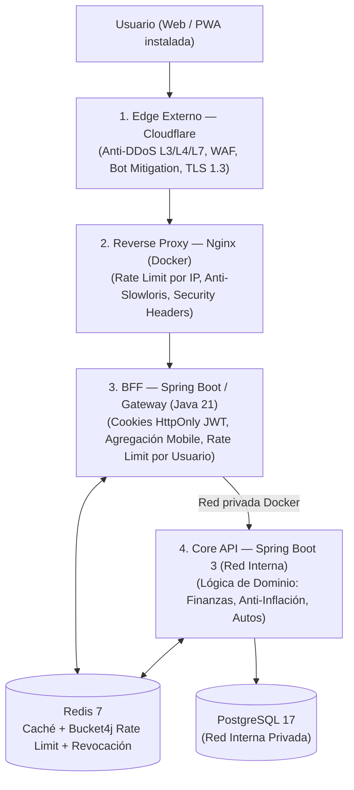

# 09 — Seguridad Perimetral (Anti-DDoS / Anti-Scrapeo), BFF y Caché

Este documento define las capas adicionales de protección, desacoplamiento y rendimiento delante del Core Backend de **FamiliON**.

---

## 1. Arquitectura de Tráfico (Defensa en Profundidad)

> **Aislamiento de red:** En `docker-compose.yml` existirán dos redes: `public_net` (solo `nginx`) y `internal_net` (`nginx`, `bff`, `backend`, `redis`, `postgres`). Ni PostgreSQL, ni Redis, ni el Core Backend exponen puertos públicos a Internet.

---

## 2. Primera Capa: Bloqueo de DDoS, Fuerza Bruta y Scrapeo

### 2.1 Borde Externo (Producción — Cloudflare)
- Proxy naranja activado sobre el dominio (oculta la IP real del servidor).
- Protección automática contra ataques volumétricos **DDoS L3/L4/L7**.
- **WAF + Bot Fight Mode:** bloquea bots conocidos, scanners de vulnerabilidades y tráfico anómalo antes de que llegue al servidor.
- **TLS 1.3 Full (Strict)** obligatorio.

### 2.2 Reverse Proxy en Docker (`edge/nginx.conf`)
Actúa como primera barrera local (tanto en producción detrás de Cloudflare como en staging):
- **Rate Limiting por IP (`limit_req_zone`):**
  - Zona estricta de autenticación y emails (`/bff/auth/login`, `/bff/auth/register`, `/bff/auth/forgot-password`, `/bff/auth/2fa/*`): máx. **5 req/min** por IP (`burst=3 nodelay`) + cooldown de 60 s por usuario en Redis para impedir *email bombing* y fuerza bruta sobre códigos 2FA de 6 dígitos.
  - Zona general de API (`/bff/*`): máx. **60 req/min** por IP (`burst=20`).
  - Límite de conexiones simultáneas (`limit_conn`): máx. **20 conexiones** por IP.
- **Protección Anti-Slowloris y payloads abusivos:**
  - `client_body_timeout 10s`, `client_header_timeout 10s`, `keepalive_timeout 15s`.
  - `client_max_body_size 1m` por defecto (ampliado a `6m` únicamente en `/bff/receipts/scan`).
- **Anti-Scrapeo básico en el borde:**
  - Bloqueo de métodos HTTP no utilizados (`TRACE`, `TRACK`, `OPTIONS` abusivos).
  - Descarte de User-Agents vacíos o herramientas automatizadas obvias de scraping masivo.
  - Desactivación de `server_tokens off` (no expone versiones de Nginx/Java).
- **Security Headers obligatorios:**
  - `Strict-Transport-Security: max-age=31536000; includeSubDomains`
  - `Content-Security-Policy` estricta (solo scripts/estilos del propio origen y fuentes permitidas).
  - `X-Content-Type-Options: nosniff`, `X-Frame-Options: DENY`, `Referrer-Policy: strict-origin-when-cross-origin`.

### 2.3 Controles Anti-Scrapeo en el BFF y Core API
- **Bucket4j + Redis por usuario autenticado:** impide que una cuenta comprometida o script automatizado extraiga datos en masa.
- **Paginación acotada:** `size` máximo estricto de `50` registros por consulta (nunca endpoints sin límite).
- **Anti-enumeración:** todas las entidades usan `UUID` aleatorios y cada query valida obligatoriamente `family_id` del token.
- **Bloqueo progresivo de login:** tras 5 intentos fallidos por email/IP, cooldown exponencial en Redis.

---

## 3. Capa BFF (Backend for Frontend)

Implementado en **Java 21 + Spring Boot 3 (Maven)** dentro de `bff/` para compartir lenguaje, tooling y contratos con el Core Backend.

### Responsabilidades del BFF
1. **Seguridad de sesión (Token Handler Pattern):**
   - La PWA Angular **no guarda JWT en `localStorage`** (elimina robo por XSS).
   - Al hacer login, el BFF recibe los tokens del Core Backend y los envía al navegador en cookies **`HttpOnly; Secure; SameSite=Strict`** (junto con token CSRF `XSRF-TOKEN` legible por Angular).
   - En cada request de la PWA, el BFF valida la cookie, verifica CSRF y reenvía el `Authorization: Bearer <jwt>` hacia el Core API por red interna.
2. **Agregación y payloads livianos para Mobile/PWA:**
   - Reduce latencia en redes móviles (4G/5G) agrupando llamadas en paralelo (Virtual Threads de Java 21):
     - `GET /bff/home` → combina balance del período + datos del gráfico de torta + últimos 10 movimientos + cotización activa + contador de notificaciones no leídas en **1 solo request**.
     - `GET /bff/plan` → combina divisas (con TC promedio de compra) + cuotas activas + gastos fijos del mes + metas.
     - `GET /bff/vehicles/{id}/dashboard` → combina ficha del auto + métricas `km/L` y `$/km` + alertas de desgaste + últimas cargas.
3. **Ocultamiento del Core:**
   - El frontend nunca ve puertos ni endpoints internos del Core API. Si el Core se refactoriza o escala a futuro, el BFF absorbe el cambio sin romper versiones viejas de la PWA.

---

## 4. Estrategia de Caché con Redis 7

Se incorpora **Redis 7** (con política `maxmemory-policy allkeys-lru` y persistencia ligera desactivada para caché pura) con tres usos diferenciados:

| Dominio / Clave Redis | TTL | Estrategia de Invalidación | Beneficio |
|---|---|---|---|
| `econ:latest:{indexCode}` | 30 min | Se refresca por `@Scheduled` diario y ante carga manual (`POST /economics/indices/manual`). | Cero latencia en conversión ARS/USD/EUR/IPC; protege ante caídas de APIs externas. |
| `econ:history:{indexCode}:{yyyy-MM}` | 24 hs | Inmutable para meses cerrados; invalidación manual si se corrige un valor. | Cálculo instantáneo de *«A plata de hoy»* en gráficos anuales. |
| `family:{familyId}:analytics:{hash}` | 5 min | **Invalidación inmediata** al crear, editar o eliminar cualquier `Transaction`, `InstallmentPlan` o `CurrencyExchange` de esa familia. | Dashboards y gráficos de torta ultrarrápidos sin mostrar nunca datos viejos tras guardar un gasto. |
| `family:{familyId}:categories` | 1 hora | Invalidación al crear/editar categorías de la familia. | Carga instantánea del popup `+` de carga rápida. |
| `rl:ip:{ip}:{route}` y `rl:user:{userId}` | Ventana deslizante (1 min) | Expiración automática (Bucket4j). | Rate limiting distribuido anti-DDoS y anti-scrapeo. |
| `auth:revoked:{jti}` | Tiempo restante del Access Token (≤15 min) | Expiración automática. | Logout inmediato y revocación instantánea de sesiones comprometidas. |

### Regla de Oro de Caché Financiera
- **Nunca cachear mutaciones ni saldos durante escrituras:** toda creación/edición de transacción va directa a PostgreSQL en transacción ACID y dispara la invalidación de las claves `family:{familyId}:analytics:*` al confirmar el commit (`@TransactionalEventListener(phase = AFTER_COMMIT)`).
- Si Redis sufriera una caída temporal, el sistema hace **fallback seguro a PostgreSQL** (degradación elegante, sin tirar abajo la app).
