# FamiliON — Plan Maestro de Implementación

Plan ejecutable por **workers autónomos** (Antigravity u otros agentes). Cada tarea es una **tarjeta autocontenida** en [`tareas/`](./tareas/): el worker solo necesita leer **su tarjeta** + [`00-reglas-worker.md`](./00-reglas-worker.md). [`01-contratos-globales.md`](./01-contratos-globales.md) es la fuente de verdad de los contratos compartidos (las tarjetas ya copian el fragmento que necesitan).

---

## 1. Reglas de despacho (para quien orquesta)

1. **Máximo 3 workers generando código en simultáneo.** Cada fase se divide en **olas** de 1 a 3 tareas.
2. **Dentro de una ola, las tareas son 100% independientes:** tocan conjuntos de archivos disjuntos y se comunican solo por contratos definidos de antemano (DTOs, rutas, interfaces Java). Pueden mergearse en cualquier orden.
3. **Entre olas hay orden:** una ola empieza cuando **todas** las PRs de la ola anterior están mergeadas en `develop` (cada tarjeta indica `Requiere mergeado`).
4. **Flujo git:** cada tarea crea su rama desde `origin/develop` → commits convencionales → push → **PR a `develop`**. `main` solo recibe merges desde `develop` al cerrar una fase (tag `vX.Y.0`).
5. **Migraciones Flyway:** la versión reservada de cada tarea es `V<número de tarea>` (ej. T13 → `V13__...sql`). Así nunca colisionan y quedan en orden ascendente.
6. Al terminar una fase: PR `develop → main`, tag SemVer y release (ver §4).

### Despacho en Orca (workers Antigravity)

Cada tarea se lanza como worker supervisado de Orca, en una worktree nueva basada en `origin/develop`:

```bash
orca orchestration worker-start --environment local --agent antigravity \
  --worktree new-top-level --repo id:<repoId FamiliON> --base-branch origin/develop \
  --name <rama-con-guiones> --task-title "TXX <título>" --spec-file <spec>.md
```

Plantilla mínima del spec (el worker solo lee 2 archivos):

```text
FamiliON task TXX — <título>.
Read ONLY: <abs>/docs/plan/00-reglas-worker.md and <abs>/docs/plan/tareas/TXX-*.md
Rename your branch to exactly `<rama>` before committing.
Allowed edit surface: <copiado de la tarjeta>.
Never add Co-Authored-By or AI mentions. Never use heredocs; pass files.
Never end your turn while a long command runs (npm install, mvn verify, docker build): wait for it.
Done = all "Verificación" commands green → push → gh pr create --base develop → worker_done with PR URL and evidence.
```

---

## 2. Fases, olas y tareas

Leyenda de capas: **BE** = Core API (`backend/`), **BFF** = `bff/`, **FE** = Angular (`frontend/`), **OPS** = infraestructura/CI.

### Fase 0 — Fundaciones (→ `v0.1.0`)
Objetivo: monorepo que levanta con `docker compose up`, con CI verde, BFF y plataforma común de seguridad.

| Ola | Tarea | Capa | Rama | Resumen |
|---|---|---|---|---|
| 0.1 | [T01](./tareas/T01-backend-scaffold.md) | BE | `feat/backend-scaffold` | Spring Boot 3 + Maven + Flyway V1 (schema completo) + Testcontainers + Dockerfile. |
| 0.1 | [T02](./tareas/T02-frontend-scaffold.md) | FE | `feat/frontend-scaffold` | Angular + Tailwind + PWA + tokens de tema + mapa de rutas con placeholders + Dockerfile. |
| 0.1 | [T03](./tareas/T03-infra-compose-edge.md) | OPS | `feat/infra-compose-edge` | `docker-compose.yml` (7 servicios, 2 redes), Nginx edge, `.env.example`, `Makefile`. |
| 0.2 | [T04](./tareas/T04-bff-scaffold.md) | BFF | `feat/bff-scaffold` | BFF: cookies `HttpOnly`, CSRF, proxy `/bff/api/**`, rate limit Redis. |
| 0.2 | [T05](./tareas/T05-ci-cd-workflows.md) | OPS | `feat/ci-cd-workflows` | `ci.yml`, `cd-staging.yml`, `cd-release.yml`, PR template, `.editorconfig`. |
| 0.2 | [T06](./tareas/T06-backend-platform-security.md) | BE | `feat/backend-platform-security` | JWT resource server, `CurrentUser`, `VisibilityPolicy`, errores RFC 7807, Redis, eventos. |

### Fase 1 — Identidad, Familia y Motor Económico (→ `v0.1.x`)
| Ola | Tarea | Capa | Rama | Resumen |
|---|---|---|---|---|
| 1.1 | [T07](./tareas/T07-backend-auth-core.md) | BE | `feat/backend-auth-core` | Registro, login, refresh rotatorio, logout, `/auth/me`, preferencias. |
| 1.1 | [T08](./tareas/T08-frontend-shell-ui-kit.md) | FE | `feat/frontend-shell-ui-kit` | Shell (header, bottom nav, sidebar desktop), tema/acento, contexto de vista y UI kit compartido. |
| 1.1 | [T09](./tareas/T09-backend-economics.md) | BE | `feat/backend-economics` | Índices (DolarApi/ArgentinaDatos), sync programado, carga manual, caché, `EconomicsApi` (snapshot y lentes). |
| 1.2 | [T10](./tareas/T10-backend-family.md) | BE | `feat/backend-family` | Settings de familia, divisas, miembros, invitaciones, visibilidad, `register-invite`. |
| 1.2 | [T11](./tareas/T11-backend-email-security.md) | BE | `feat/backend-email-security` | Verificación de email, 2FA por OTP, dispositivos confiables, olvido/reset de contraseña, mails Thymeleaf. |
| 1.2 | [T12](./tareas/T12-frontend-auth.md) | FE | `feat/frontend-auth` | Pantallas de auth, guard, interceptor de refresh, `AuthStore`. |

### Fase 2 — MVP Core Financiero (→ `v0.2.0`)
| Ola | Tarea | Capa | Rama | Resumen |
|---|---|---|---|---|
| 2.1 | [T13](./tareas/T13-backend-accounts-categories.md) | BE | `feat/backend-accounts-categories` | Cuentas (con saldo), categorías jerárquicas, seed de categorías del sistema. |
| 2.1 | [T14](./tareas/T14-frontend-profile-family.md) | FE | `feat/frontend-profile-family` | Perfil (tema, color + picker), familia, miembros, invitaciones, seguridad. |
| 2.1 | [T15](./tareas/T15-frontend-accounts-categories.md) | FE | `feat/frontend-accounts-categories` | Pantalla de cuentas y categorías + servicios/stores compartidos de finanzas. |
| 2.2 | [T16](./tareas/T16-backend-transactions.md) | BE | `feat/backend-transactions` | Movimientos, transferencias, atribución, vistas, snapshot económico, `TransactionCommandApi`. |
| 2.2 | [T17](./tareas/T17-frontend-quick-add.md) | FE | `feat/frontend-quick-add` | Carga rápida `+` en 3 toques (sheet mobile / modal desktop) con cuotas anti-ambigüedad. |
| 2.2 | [T18](./tareas/T18-frontend-home.md) | FE | `feat/frontend-home` | Inicio: hero de balance, donut Categorías/Personas, últimos movimientos (vía `/bff/home`). |
| 2.3 | [T19](./tareas/T19-backend-analytics.md) | BE | `feat/backend-analytics` | Summary, series, by-category, by-person, calendar con las 4 lentes + caché. |
| 2.3 | [T20](./tareas/T20-backend-currency-exchanges.md) | BE | `feat/backend-currency-exchanges` | Compra/venta de divisas con TC real y precio promedio ponderado. |
| 2.3 | [T21](./tareas/T21-bff-home.md) | BFF | `feat/bff-home-aggregation` | `GET /bff/home` agregando 5 llamadas en paralelo (virtual threads). |
| 2.4 | [T22](./tareas/T22-frontend-analytics.md) | FE | `feat/frontend-analytics` | Analítica: granularidad, lentes, serie, donuts, calendario. |
| 2.4 | [T23](./tareas/T23-frontend-transactions.md) | FE | `feat/frontend-transactions` | Listado de movimientos con filtros, edición y baja. |
| 2.4 | [T24](./tareas/T24-frontend-exchanges.md) | FE | `feat/frontend-exchanges` | Pantalla de compra/venta de divisas e historial con PPP. |

### Fase 3 — Planificación: Cuotas, Fijos, Metas y Mensualidades (→ `v0.3.0`)
| Ola | Tarea | Capa | Rama | Resumen |
|---|---|---|---|---|
| 3.1 | [T25](./tareas/T25-backend-installments.md) | BE | `feat/backend-installments` | Planes de cuotas con/sin interés, cronograma según cierre de tarjeta, precancelación. |
| 3.1 | [T26](./tareas/T26-backend-recurring-expenses.md) | BE | `feat/backend-recurring-expenses` | Gastos fijos con reglas de ajuste, pendientes del mes y confirmación de pago. |
| 3.1 | [T27](./tareas/T27-backend-savings-goals.md) | BE | `feat/backend-savings-goals` | Metas en unidad estable, aportes con conversión, ahorro mensual sugerido. |
| 3.2 | [T28](./tareas/T28-backend-allowances.md) | BE | `feat/backend-allowances` | Mensualidades de hijos, acreditación sin doble conteo, scheduler. |
| 3.2 | [T29](./tareas/T29-bff-plan.md) | BFF | `feat/bff-plan-aggregation` | `GET /bff/plan` (divisas + cuotas + fijos + metas + mensualidades). |
| 3.2 | [T30](./tareas/T30-frontend-installments-recurring.md) | FE | `feat/frontend-installments-recurring` | Pantallas de cuotas y gastos fijos. |
| 3.3 | [T31](./tareas/T31-frontend-goals-allowances.md) | FE | `feat/frontend-goals-allowances` | Pantallas de metas y mensualidades. |
| 3.3 | [T32](./tareas/T32-frontend-plan-overview.md) | FE | `feat/frontend-plan-overview` | Pantalla resumen "Plan" consumiendo `/bff/plan`. |

### Fase 4 — Vehículos (→ `v0.4.0`)
| Ola | Tarea | Capa | Rama | Resumen |
|---|---|---|---|---|
| 4.1 | [T33](./tareas/T33-backend-vehicles.md) | BE | `feat/backend-vehicles` | Vehículos, combustible, mantenimiento, métricas, alertas, integración contable ACID. |
| 4.1 | [T34](./tareas/T34-frontend-vehicles.md) | FE | `feat/frontend-vehicles` | Autos: listado, ficha/dashboard, carga de combustible y service. |
| 4.1 | [T35](./tareas/T35-bff-vehicle-dashboard.md) | BFF | `feat/bff-vehicle-dashboard` | `GET /bff/vehicles/{id}/dashboard`. |

### Fase 5 — Notificaciones, PWA y Endurecimiento (→ `v0.5.0`)
| Ola | Tarea | Capa | Rama | Resumen |
|---|---|---|---|---|
| 5.1 | [T36](./tareas/T36-backend-notifications.md) | BE | `feat/backend-notifications` | Notificaciones in-app, Web Push VAPID, versión/changelog, alertas programadas. |
| 5.1 | [T37](./tareas/T37-frontend-notifications-pwa.md) | FE | `feat/frontend-notifications-pwa` | Campana, centro de notificaciones, `SwUpdate`, prompt de instalación, "Qué cambió". |
| 5.1 | [T38](./tareas/T38-e2e-smoke.md) | OPS | `feat/e2e-smoke-tests` | Playwright E2E smoke sobre docker compose + job de CI. |

### Fase 6 — OCR de Tickets y Exportaciones (→ `v0.6.0`)
| Ola | Tarea | Capa | Rama | Resumen |
|---|---|---|---|---|
| 6.1 | [T39](./tareas/T39-backend-receipts-ocr.md) | BE | `feat/backend-receipts-ocr` | `ReceiptParserPort`, almacenamiento, OCR asíncrono (adapter Tesseract + stub). |
| 6.1 | [T40](./tareas/T40-backend-exports.md) | BE | `feat/backend-exports` | Exportación CSV/XLSX de movimientos y resúmenes. |
| 6.1 | [T41](./tareas/T41-frontend-scan-exports.md) | FE | `feat/frontend-scan-exports` | Cámara/OCR en carga rápida y botones de exportación. |

> `v1.0.0` = Fase 0–5 estables en uso diario por la familia. Fase 6 puede entrar como `v1.1.0` si se prioriza estabilidad.

---

## 3. Mapa de dependencias entre olas

```mermaid
flowchart LR
  O01["Ola 0.1\nT01 T02 T03"] --> O02["Ola 0.2\nT04 T05 T06"]
  O02 --> O11["Ola 1.1\nT07 T08 T09"]
  O11 --> O12["Ola 1.2\nT10 T11 T12"]
  O12 --> O21["Ola 2.1\nT13 T14 T15"]
  O21 --> O22["Ola 2.2\nT16 T17 T18"]
  O22 --> O23["Ola 2.3\nT19 T20 T21"]
  O23 --> O24["Ola 2.4\nT22 T23 T24"]
  O24 --> O31["Ola 3.1\nT25 T26 T27"]
  O31 --> O32["Ola 3.2\nT28 T29 T30"]
  O32 --> O33["Ola 3.3\nT31 T32"]
  O33 --> O41["Ola 4.1\nT33 T34 T35"]
  O41 --> O51["Ola 5.1\nT36 T37 T38"]
  O51 --> O61["Ola 6.1\nT39 T40 T41"]
```



---

## 4. Cierre de fase (release)

1. Todas las PRs de la fase mergeadas en `develop` con CI verde.
2. Smoke manual: `make up` → registrar familia → flujo principal de la fase.
3. PR `develop → main` titulada `release: vX.Y.0`.
4. Tras el merge: `git tag vX.Y.0 && git push origin vX.Y.0` (dispara `cd-release.yml`).
5. Cargar la nota de versión en `app_releases` (a partir de T36 vía migración o endpoint).

---

## 6. Pendientes post-plan

- Optimizar bundle inicial (~715 kB vs presupuesto 500 kB).
- Campana de notificaciones en el header mobile.
- Alta directa de operaciones SWAP (divisa → divisa) en la UI.
- Unificar el menú de exportación en `shared/ui`.
- Agregar `receiptAttachmentId` a `TransactionCreate` en `core/finance`.
- Revisar PRs de Dependabot (#9–#18): varias son majors incompatibles.
- Releases `develop → main` por fase (tags SemVer).

## 5. Seguimiento

| Tarea | Estado | PR | Notas |
|---|---|---|---|
| T01 | mergeada | [#2](https://github.com/tommikimmel/familiON/pull/2) | verify, diff de schema y docker build en verde |
| T02 | mergeada | [#4](https://github.com/tommikimmel/familiON/pull/4) | Angular 22.3; CI verde |
| T03 | mergeada | [#1](https://github.com/tommikimmel/familiON/pull/1) | compose y `nginx -t` OK |
| T04 | mergeada | [#7](https://github.com/tommikimmel/familiON/pull/7) | CI verde |
| T05 | mergeada | [#5](https://github.com/tommikimmel/familiON/pull/5) | CI activo en GitHub |
| T06 | mergeada | [#8](https://github.com/tommikimmel/familiON/pull/8) | reabierta como #8 (la #6 se cerró al borrar su base) |
| T07 | mergeada | [#19](https://github.com/tommikimmel/familiON/pull/19) | 36 unit + 38 IT; ajuste aprobado en `SecurityIT` |
| T08 | mergeada | [#21](https://github.com/tommikimmel/familiON/pull/21) | 82 tests; usa `@lucide/angular` (lucide-angular deprecado) |
| T09 | mergeada | [#20](https://github.com/tommikimmel/familiON/pull/20) | 48 unit + 32 IT; EUR_BLUE solo manual (DolarApi no lo expone) |
| T10 | mergeada | [#23](https://github.com/tommikimmel/familiON/pull/23) | 132 tests; invitación pública vía SecurityFilterChain propio |
| T11 | mergeada | [#25](https://github.com/tommikimmel/familiON/pull/25) | 134 tests; plantillas Thymeleaf |
| T12 | mergeada | [#24](https://github.com/tommikimmel/familiON/pull/24) | 116 tests; 3 ajustes aprobados fuera de alcance |
| T13 | mergeada | [#28](https://github.com/tommikimmel/familiON/pull/28) | 31 categorías de sistema (la tarjeta decía 32 por error) |
| T14 | mergeada | [#26](https://github.com/tommikimmel/familiON/pull/26) | 134 tests |
| T15 | mergeada | [#27](https://github.com/tommikimmel/familiON/pull/27) | amplió `fo-icon` con íconos de cuentas/categorías (aprobado) |
| T16–T41 | mergeadas | #30–#65 | ver historial de PRs en GitHub; T36 y T41 terminadas por workers Claude (cuota semanal de Antigravity agotada) |
